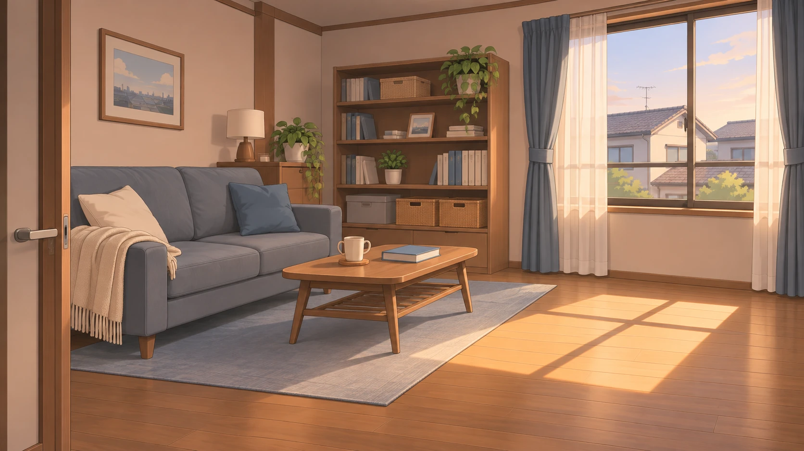
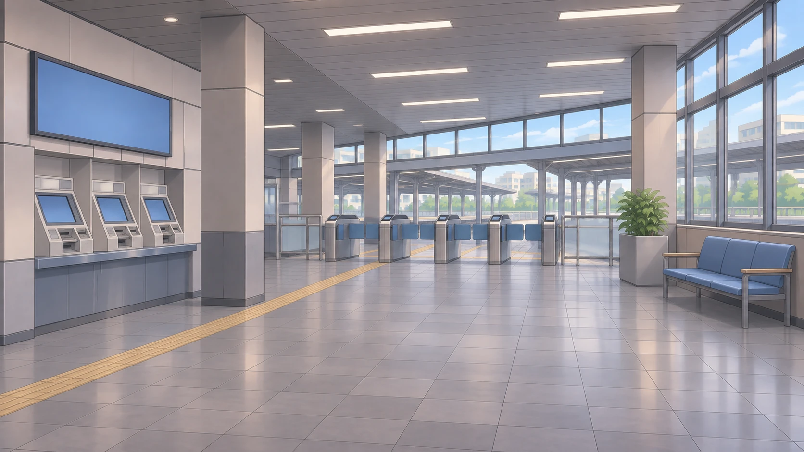

# 南の島の CG 背景（背景）

背景の画風の見本（5 枚）。この画風で背景を描くときの見本です。

https://raw.githubusercontent.com/kaniramen132-dev/bg-style-samples/main/bgs_20261114_031822/sample_1.png

https://raw.githubusercontent.com/kaniramen132-dev/bg-style-samples/main/bgs_20261114_031822/sample_2.png

https://raw.githubusercontent.com/kaniramen132-dev/bg-style-samples/main/bgs_20261114_031822/sample_3.png

https://raw.githubusercontent.com/kaniramen132-dev/bg-style-samples/main/bgs_20261114_031822/sample_4.png

https://raw.githubusercontent.com/kaniramen132-dev/bg-style-samples/main/bgs_20261114_031822/sample_5.png
