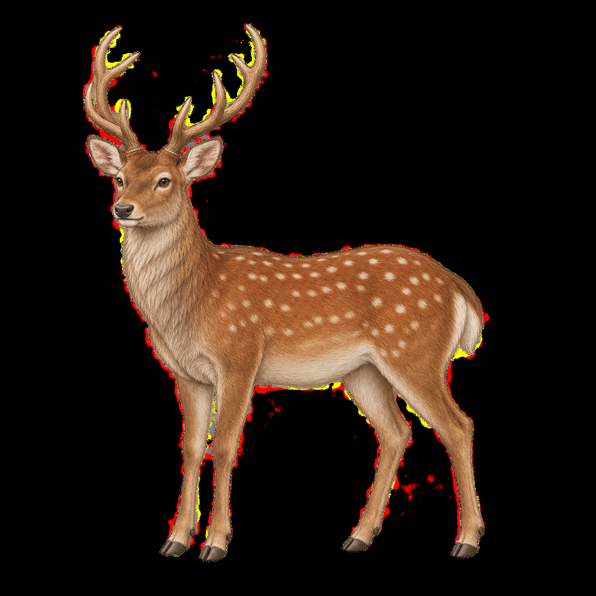
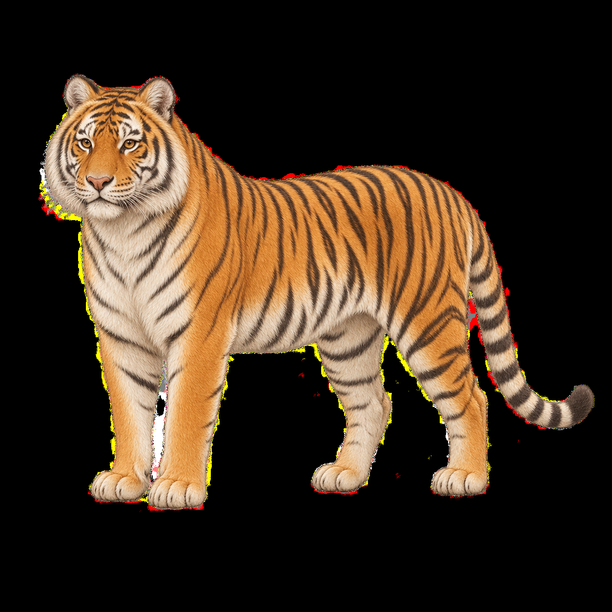
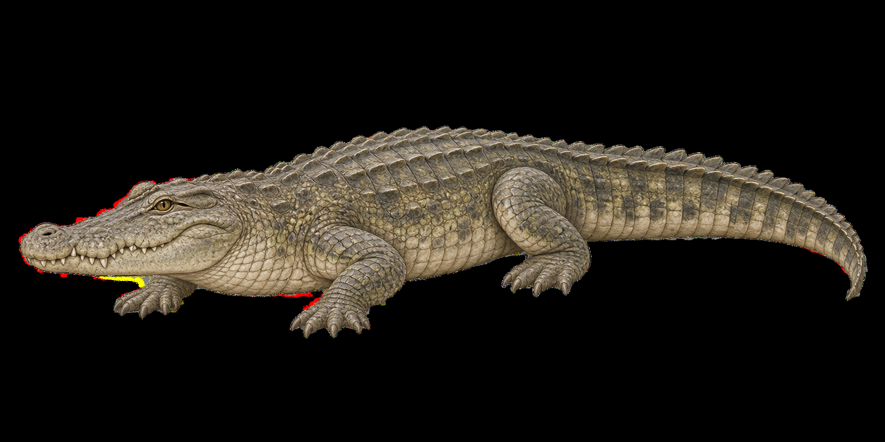
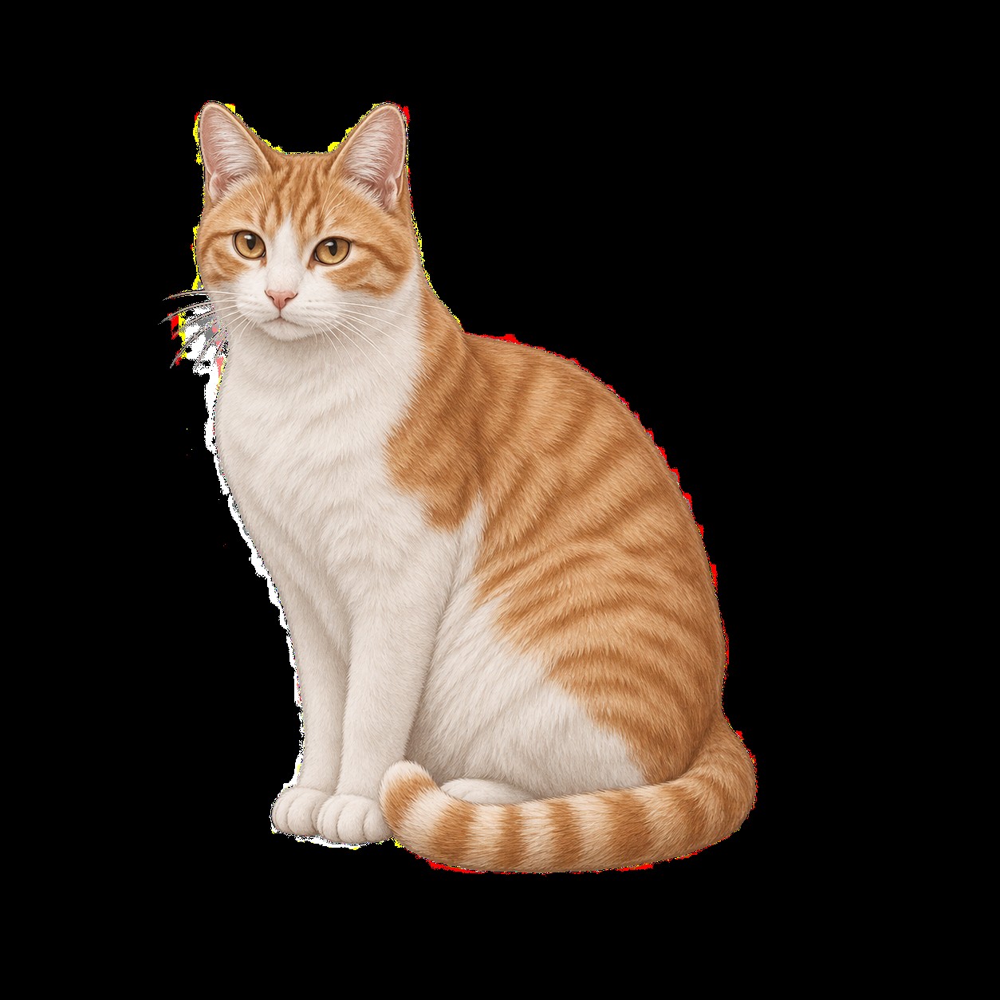

# 動物1（動物）

動物の画風の見本（4 枚）。この画風で動物を描くときの見本です。

https://raw.githubusercontent.com/kaniramen132-dev/bg-style-samples/main/bgs_20261114_155913/sample_1.png

https://raw.githubusercontent.com/kaniramen132-dev/bg-style-samples/main/bgs_20261114_155913/sample_2.png

https://raw.githubusercontent.com/kaniramen132-dev/bg-style-samples/main/bgs_20261114_155913/sample_3.png

https://raw.githubusercontent.com/kaniramen132-dev/bg-style-samples/main/bgs_20261114_155913/sample_4.png
